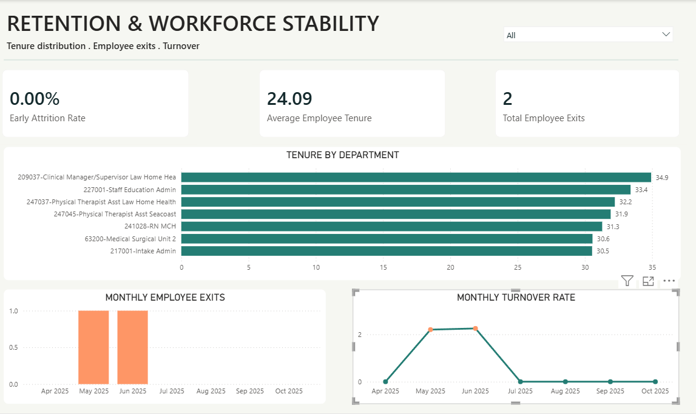
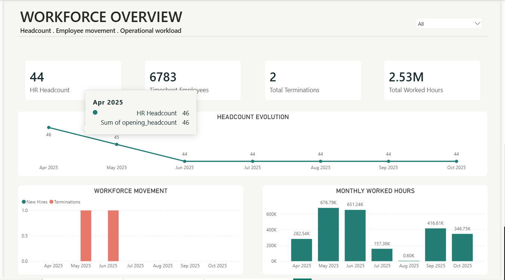
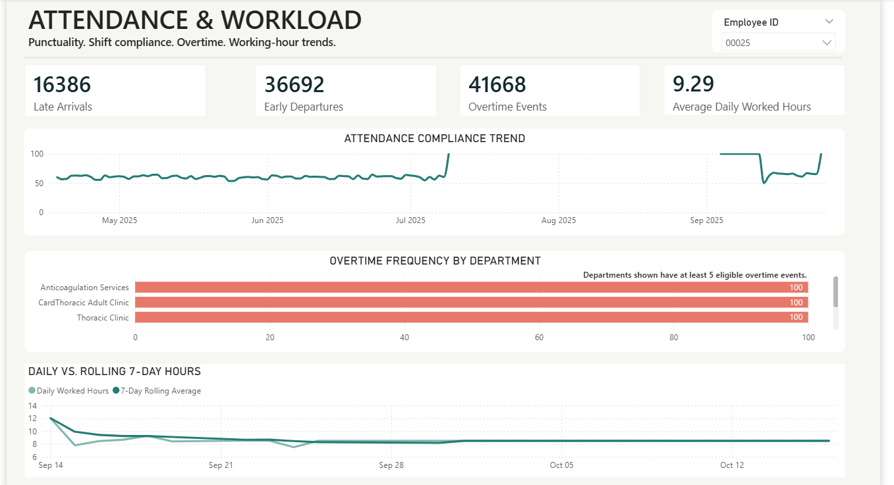

# Workforce-Analytics — ETL to Insights

A reproducible **employee and timesheet data engineering pipeline** built with **Python, pandas, PostgreSQL, MinIO, Parquet, Luigi, SQL, FastAPI and Power BI**. The project transforms overlapping raw exports into quality-controlled relational tables, analytical data marts, report CSVs and interactive workforce visualizations.

## Architecture

```text
Raw employee/timesheet CSVs (local OR MinIO)
  └─ Bronze ingestion → PostgreSQL raw tables + lineage/Parquet
      └─ Silver normalization, validation, auditing, deduplication
          └─ Gold: dim_employee + dim_date + fact_timesheet
              └─ SQL marts & 9 required + 6 supplementary KPIs
                  └─ 13 CSV report exports → Power BI (3 report pages)

FastAPI admin edits → api.employee ledger → Silver overlay
                                      → Gold publication → revision acknowledgment
```

MinIO source mode selects raw CSV **input to Bronze**; Silver currently reads locally staged Bronze Parquet. PostgreSQL/MinIO run via Compose; Python, Luigi, FastAPI and Power BI run on the host. The application is designed for a controlled development/assignment environment rather than a fully containerized production deployment.

## Validated reference snapshot

| Measure | Observed value |
|---|---:|
| Original source records | 412,621 (50 employee + 412,571 timesheet) |
| Deduplicated timesheet events | 381,732 |
| Duplicate occurrences audited | 30,839 |
| Gold employee identities | 10,794 (only 50 source profiles) |
| Gold date rows | 183 |
| Analytics exports | 13 |

**October 19, 2026 verification:** local and MinIO full Luigi workflows each completed **9/9 tasks**, **22/22 SQL analytics tests passed**, and **13/13 CSV exports passed** manifest integrity checks. FastAPI manual admin/viewer role checks returned expected 200/403 outcomes; the Phase 7 report contains earlier 44-test API regression evidence. Data interpretation is limited by incomplete employee-profile coverage and unresolved pay-code classifications. See [`docs/FINAL_VERIFICATION.md`](docs/FINAL_VERIFICATION.md).

## Quick start

```powershell
# From repository root after configuring .env and source CSVs
python -m venv .venv
.\.venv\Scripts\Activate.ps1
pip install -r requirements.txt
docker compose up -d

# In terminal 1
luigid --address 127.0.0.1 --port 8082

# In terminal 2 (after first-time database initialization)
python -m src.orchestration.pipeline --source local
# Or: python -m src.orchestration.pipeline --source minio
python -m tests.verify_analytics_reports
```

**For a clean first-time installation do not skip** [`docs/SETUP_GUIDE.md`](docs/SETUP_GUIDE.md): it covers `.env`, MinIO raw uploads, initial Silver/Gold tables, operational API initialization and admin bootstrap. The raw source CSVs and private credentials are **not** included in the public repository.

To serve the API:

```powershell
uvicorn src.api.main:app --host 127.0.0.1 --port 8000
```

Browse [Swagger UI](http://127.0.0.1:8000/docs). `admin` users can manage employees; authenticated `viewer` users have read-only access to employee/timesheet routes. Viewer writes correctly return **403 Forbidden**. There is no required custom web frontend.

Open `powerbi/ASE_Workforce_Intelligence.pbix` in Power BI Desktop. The file uses a **fixed verified October 18 reporting snapshot**; it does not automatically switch to a later pipeline run. Follow the usage guide before changing Power Query paths.


## Power BI Dashboard

The Power BI report contains three interactive pages:

- Workforce Overview
- Retention & Workforce Stability
- Attendance & Workload





## Documentation

- **[Engineering report](docs/ASE_ETL_Final_Engineering_Report.md)** — architecture, Phases 1–9, engineering decisions, redesigns, trade-offs, open boundaries and assessment.
- **[Setup guide](docs/SETUP_GUIDE.md)** — environment, Docker, input staging, first-time DB/API initialization and validation.
- **[Usage guide](docs/USAGE_GUIDE.md)** — normal/rerun commands, safe recovery, FastAPI roles, report exports and Power BI.
- **[Schema guide](docs/DATABASE_SCHEMA.md)** — Mermaid ER diagram, fields, primary/foreign keys, registries and SQL KPI map.
- **[Verification register](docs/FINAL_VERIFICATION.md)** — final observed commands, outputs and test evidence scope.
- **[Phase implementation reports](docs/phases/)** — detailed Phase 1–9 reports, including the original and revised Silver implementations.

## Security and scope

Never commit `.env`, access tokens, personal CSV exports, generated report folders or sensitive employee data. Inspect `git status` and staged changes before pushing. All published metrics are educational/assignment analytics: employee HR coverage is sparse, overtime is a schedule/punch **proxy**, and unknown pay codes are not assumed to mean worked time.

