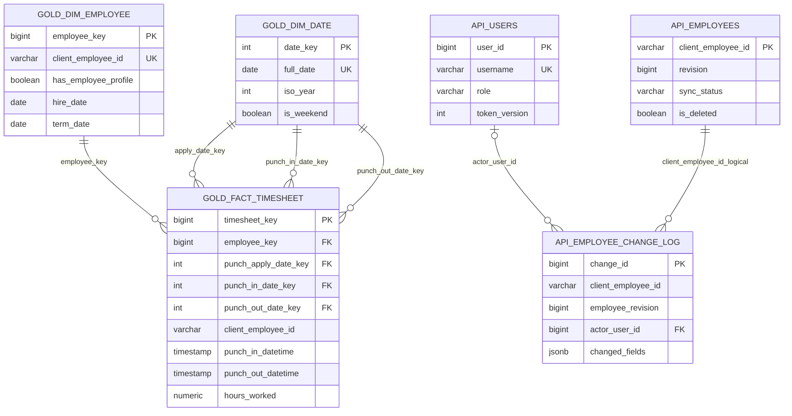

# ASE-ETL | Database Schema and Data Contracts

**Database engine:** PostgreSQL 16. **Logical design:** Bronze raw objects; Silver cleaned relational data; Gold dimensional warehouse; `mart` SQL analytics; `api` operational write model. The tables and fields below are sourced from checked-in migrations and the Phase 4–8 implementation reports. Use `information_schema` or PostgreSQL's `\d` command for a complete environment-specific physical column audit.

## 1. Entity relationship diagram



**Diagram scope:** `GOLD_DIM_*` and `GOLD_FACT_*` depict actual foreign keys; the API employee-to-change-log connection is **logical by ID**, not necessarily a declared PostgreSQL foreign key (the ledger preserves history across operational changes). One shared `dim_date` is referenced in three different roles. Publication registries and audit objects are omitted from the diagram for readability.

## 2. Schema-level ownership

| PostgreSQL schema | Representative objects | Responsibility |
|---|---|---|
| `bronze` | source-specific `*_raw`; `_ingestion_registry` | Immutable-source representation, audit metadata, hash/idempotency records |
| `silver` | `employees`, `timesheets`, `_publication_registry` | Clean typed records, unique business keys, active published snapshot |
| `gold` | `dim_employee`, `dim_date`, `fact_timesheet`, `_publication_registry` | Integrated relational star schema and release lifecycle |
| `mart` | Classification tables/views, attendance/work-hours/workforce KPI views | SQL business rules and reporting-ready aggregations |
| `api` | `employees`, `employee_change_log`, `users`, `auth_events`, `login_attempts` | Operational employee mutations, revisions, auth and security auditing |

Object-store publications mirror relational stages, but MinIO buckets are **not** PostgreSQL schemas. Bronze/Gold publication manifests bind batches to content hashes; local Parquet is also used as processing state.

## 3. Raw and Silver contracts

The supplied employee CSV has **34 business columns**:

`client_employee_id, first_name, middle_name, last_name, preferred_name, job_code, job_title, job_start_date, organization_id, organization_name, department_id, department_name, dob, hire_date, recent_hire_date, anniversary_date, term_date, years_of_experience, work_email, address, city, state, zip, country, manager_employee_id, manager_employee_name, fte_status, is_per_deim, cell_phone, work_phone, scheduled_weekly_hour, active_status, termination_reason, clinical_level`.

The supplied timesheet CSVs have **14 business columns**:

`client_employee_id, department_id, department_name, home_department_id, home_department_name, pay_code, punch_in_comment, punch_out_comment, hours_worked, punch_apply_date, punch_in_datetime, punch_out_datetime, scheduled_start_datetime, scheduled_end_datetime`.

Bronze appends `source_file`, `source_row_number`, `ingested_at_utc`, `ingestion_batch_id` and stores source business values as strings where practical. Silver **v2** preserves the **full 38-column employee** and **18-column timesheet** approved contracts, applying typed date/time/numeric transformations and null normalization. Important types include `hours_worked NUMERIC`, `punch_apply_date DATE`, punch/schedule `TIMESTAMP`, employee dates `DATE`, `years_of_experience NUMERIC(12,2)` and text business IDs. Silver's documented relational keys are:

- `silver.employees`: primary key **`client_employee_id`**.
- `silver.timesheets`: composite primary key **`(client_employee_id, punch_in_datetime, punch_out_datetime)`**.

No source-system transaction ID was supplied. The timesheet primary key encodes a tested event-grain assumption, **not** employee/day uniqueness. Silver duplicate export detection instead compares **all 14 normalized business columns**, excluding lineage. Schema v2 accepts missing approved optional columns (insert null + audit), but rejects missing required and unapproved new columns.

The Silver auditing outputs include `audit/duplicate_records`, `audit/quality_issues`, `audit/rejected_employees`, `audit/rejected_timesheets`, `audit/schema_evolution` and, after API integration, `audit/api_employee_overrides`. Their Parquet paths are part of the reproducibility contract even where corresponding storage is not a conventional database table.

## 4. Gold dimensional tables and constraints

### `gold.dim_employee` — 24 columns

**Grain:** one record per unioned employee business identifier across published Silver roster and timesheets. **PK:** `employee_key BIGINT GENERATED ALWAYS AS IDENTITY`. **UK, NOT NULL:** `client_employee_id VARCHAR`. **Profile indicator:** `has_employee_profile BOOLEAN NOT NULL`, FALSE when only a timesheet identity is known.

Column inventory from `src/gold/migrations.py`:

`employee_key, client_employee_id, first_name, middle_name, last_name, preferred_name, job_code, job_title, job_start_date, organization_id, organization_name, department_id, department_name, hire_date, recent_hire_date, term_date, manager_employee_id, fte_status, scheduled_weekly_hour, active_status, years_of_experience, clinical_level, is_per_deim, has_employee_profile`.

Many profile columns are nullable because **10,744 identities lack source profile details**. Sensitive address, DOB and phone columns are intentionally excluded from the analytics dimension. Employee descriptions use **SCD Type 1**; current values may be updated, but no Type 2 history is promised.

### `gold.dim_date` — 12 columns

**Grain:** one calendar date. **PK:** `date_key INTEGER` encoded as `YYYYMMDD`. **UK, NOT NULL:** `full_date DATE`.

Columns: `date_key, full_date, day_of_month, day_of_week, day_name, week_of_year, month_number, month_name, quarter_number, year_number, iso_year, is_weekend`.

The current verified date range contains **183 dates** (2025-04-18 through 2025-10-17). `iso_year` prevents ISO week/year misclassification near year transitions.

### `gold.fact_timesheet` — 22 columns

**Grain:** one accepted timesheet event after Silver deduplication. **PK:** `timesheet_key BIGINT GENERATED ALWAYS AS IDENTITY`. **UK:** `(client_employee_id, punch_in_datetime, punch_out_datetime)`.

**Foreign keys (all NOT NULL):** `employee_key → gold.dim_employee.employee_key`, `punch_apply_date_key → gold.dim_date.date_key`, `punch_in_date_key → gold.dim_date.date_key`, `punch_out_date_key → gold.dim_date.date_key`.

**Columns:**

`timesheet_key, employee_key, punch_apply_date_key, punch_in_date_key, punch_out_date_key, client_employee_id, punch_in_datetime, punch_out_datetime, scheduled_start_datetime, scheduled_end_datetime, hours_worked, department_id, department_name, home_department_id, home_department_name, pay_code, punch_in_comment, punch_out_comment, source_file, source_row_number, ingested_at_utc, ingestion_batch_id`.

`hours_worked NUMERIC NOT NULL` is the source-reported amount. Actual punch elapsed time is used in distinct attendance/overtime proxy calculations, not as a replacement for it. Lineage columns allow tracing Gold facts to original raw records.

### Publication registries

- `silver._publication_registry`: active Silver snapshot, source fingerprint, version, counts, publication information.
- `gold._publication_registry`: `publication_id PK`, `silver_snapshot_fingerprint`, `gold_model_version`, `employee_count`, `date_count`, `timesheet_count`, `gold_snapshot_fingerprint`, `minio_prefix`, `publication_status`, `database_committed_at`, `published_at`. Check constraints permit `PUBLISHED` only with a complete release fingerprint, prefix and timestamp.

The registries constrain publication state and traceability, but do not create an atomic SQL/MinIO transaction.

## 5. API operational schema

| Table | Identity / important fields | Invariants |
|---|---|---|
| `api.employees` | `client_employee_id PK`, employee name/job/department/organization/date fields, `is_deleted`, `sync_status`, `revision`, timestamps | `sync_status IN ('pending','synced','failed')`; ID immutable under change trigger; soft deletes recorded |
| `api.employee_change_log` | `change_id PK`, `client_employee_id`, `employee_revision`, `operation`, `changed_fields JSONB`, `actor_user_id FK`, `changed_at` | `operation IN ('create','update','delete')`; unique `(client_employee_id, employee_revision)`; actor FK to `api.users` |
| `api.users` | `user_id PK`, `username UNIQUE`, `hashed_password`, `role`, `is_active`, `token_version`, timestamps | `role IN ('admin','viewer')`; password hash is stored, not plaintext |
| `api.auth_events` | `event_id PK`, `user_id FK`, event_type, occurred_at | Allowed success/failure/throttled events; user FK can be set NULL on delete |
| `api.login_attempts` | `identifier_hash CHAR(64) PK`, `failure_count`, `window_started_at` | Database-backed throttling; nonnegative failure count |

API-initiated writes do **not** directly edit `silver.employees` or `gold.dim_employee`. Versioned changes are replayed deterministically into Silver and acknowledged only when a matching Gold publication exists. Timesheet REST endpoints are read-only on published Gold facts.

## 6. SQL marts and KPI source map

| Required KPI | SQL view / object | Definition notes |
|---|---|---|
| Active headcount over time | `mart.workforce_monthly` | HR-profiled staff at monthly cutoffs |
| Turnover trend | `mart.workforce_monthly` | Terminations / average opening/closing headcount ×100 |
| Average tenure by department | `mart.department_tenure` | Hire to termination/cutoff, profile departments |
| Average working hours per employee | `mart.kpi_employee_working_hours` | Eligible recorded hours per observed workdays/weeks |
| Late arrival frequency | `mart.employee_attendance_daily` | >5 minutes after scheduled start |
| Early departure count | `mart.employee_attendance_daily` | >5 minutes before scheduled end |
| Total overtime count | `mart.employee_overtime_daily` | >5-minute shift-duration overrun **proxy** |
| Rolling average working hours | `mart.kpi_rolling_working_hours` | Seven-calendar-day lookback over observed eligible days |
| Early attrition rate | `mart.kpi_early_attrition` | Departure before 90 days among fully observable cohorts |

Supplementary: `mart.kpi_monthly_workload`, `mart.kpi_department_workload`, `mart.kpi_attendance_compliance`, `mart.kpi_department_overtime`, `mart.kpi_weekday_workload`, `mart.kpi_workforce_changes`. Pay-code semantics are governed by `mart.pay_code_classification`, `mart.pay_code_component` and `mart.v_timesheet_classification`, including explicit eligible/excluded/unresolved outcomes. Business views are implemented across `src/analytics/sql/01_schema.sql`–`14_performance_indexes.sql`.

## 7. Index design and quality guarantees

Gold includes PK/unique indexes protecting all dimensions/fact identities. The Phase 6 optimizer adds:

```sql
CREATE INDEX IF NOT EXISTS idx_gold_timesheet_employee_date
  ON gold.fact_timesheet (employee_key, punch_apply_date_key);
CREATE INDEX IF NOT EXISTS idx_gold_timesheet_apply_date_employee
  ON gold.fact_timesheet (punch_apply_date_key, employee_key);
CREATE INDEX IF NOT EXISTS idx_gold_employee_profile_hire_term
  ON gold.dim_employee (hire_date, term_date)
  WHERE has_employee_profile = TRUE AND hire_date IS NOT NULL;
```

These speed **some** selective access patterns, but initial timed full-table analytical scans did not universally improve. Referential integrity and repeatable migrations are more important than claiming a single across-the-board speedup. The API adds department, change-ledger and login/audit access indexes for its operational reads.

## 8. Helpful read-only inspection SQL

```sql
SELECT COUNT(*) FROM silver.employees;
SELECT COUNT(*) FROM silver.timesheets;
SELECT COUNT(*) FROM gold.dim_employee;
SELECT COUNT(*) FROM gold.dim_date;
SELECT COUNT(*) FROM gold.fact_timesheet;

SELECT has_employee_profile, COUNT(*) AS identities
FROM gold.dim_employee
GROUP BY has_employee_profile ORDER BY has_employee_profile;

SELECT publication_id, gold_model_version, publication_status,
       silver_snapshot_fingerprint, timesheet_count, published_at
FROM gold._publication_registry
ORDER BY publication_id DESC;
```

The verified supplied snapshot returned **50 Silver profiles, 381,732 Silver timesheets, 10,794 Gold identities, 183 dates and 381,732 Gold facts**. Do not hard-code these as validation expectations for all future input versions.

## 9. Modeling boundaries

The employee roster does not describe the complete timesheet identity population; Gold avoids an invalid referential drop through its identity union. Source personal fields are retained under the Silver data contract but not exposed indiscriminately in Gold. Gold SCD1 does not recreate historical employee classifications. Composite event keys and deduplication are based on observed data behavior; source-generated event IDs would improve future precision. The `mart` overtime flag is a schedule/punch duration proxy rather than an approved payroll classification, and unresolved pay codes must remain distinguishable.
